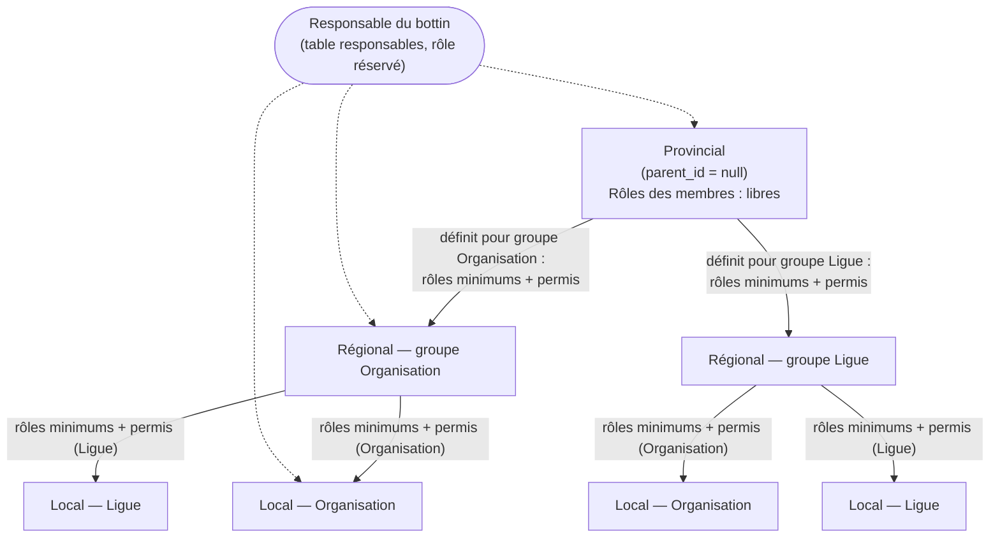

# Organigramme des rôles parent → enfant

## Règles

| Élément | Défini par | S'applique à |
|---|---|---|
| `MinimumRole` (nom, groupe) | Parent | Chaque enfant **direct** du même groupe — rôle à pourvoir obligatoirement |
| `AllowedRole` (nom, groupe) | Parent | Chaque enfant direct du même groupe — rôle optionnel permis |
| `usableRoleNames()` | Calculé sur l'enfant | `minimums ∪ permis` du parent pour le groupe de l'enfant ; `null` (libre) si pas de parent ou rien de configuré |
| `MemberRole` | Enfant | Ses membres, limités à `usableRoleNames()` |
| `Responsable du bottin` | — | Réservé ; jamais dans `MemberRole`, `MinimumRole` ni `AllowedRole` |

## Cascades (parent → enfants directs du groupe)

- Suppression d'un rôle minimum/permis → `removeChildMemberRolesNamed()` retire ce rôle aux membres des enfants ; un membre sans rôle restant est supprimé.
- Renommage → `renameChildMemberRoles()` renomme le rôle chez les membres des enfants.

## Niveaux

`Provincial → Régional → Local` (`OrganizationLevel::childLevel()`). Local n'a pas d'enfants, donc ne définit aucun rôle minimum/permis.
